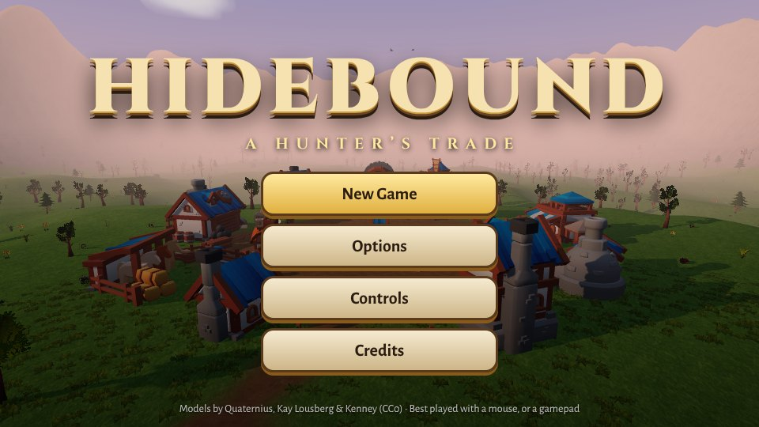
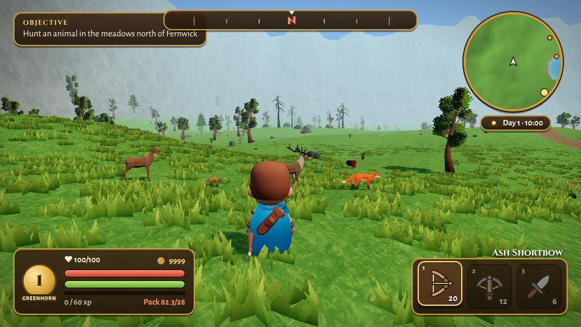
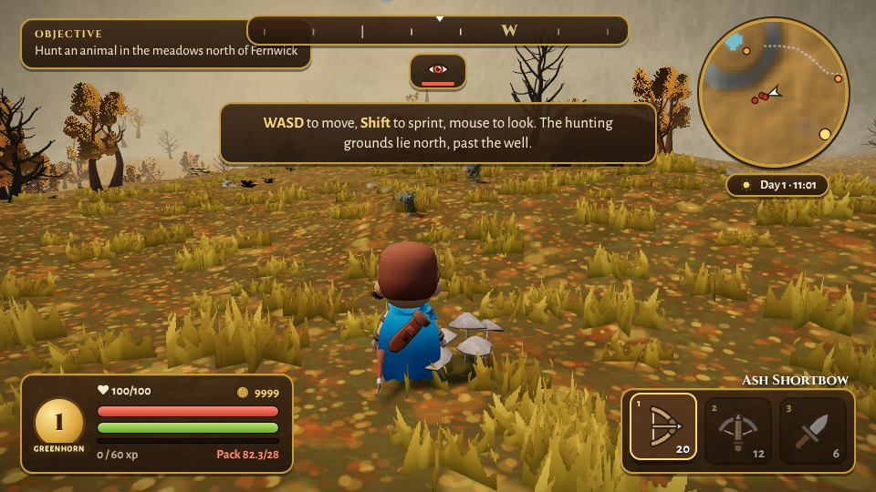
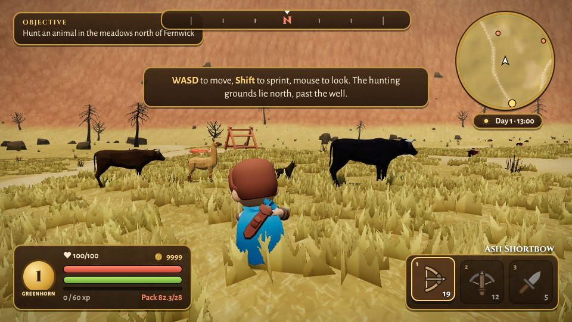
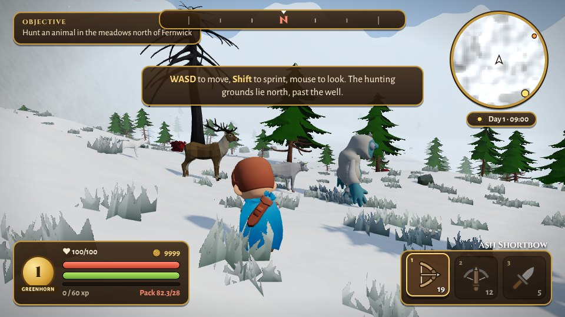
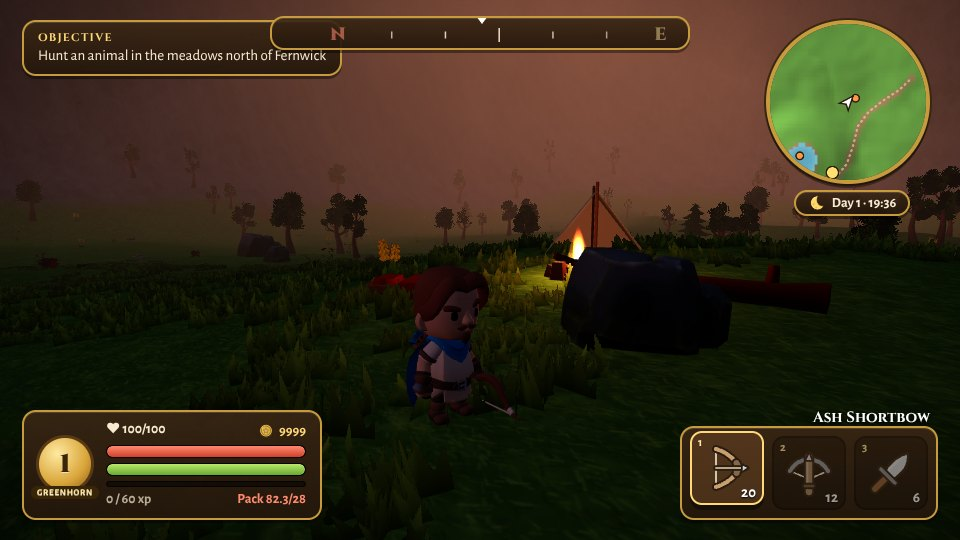
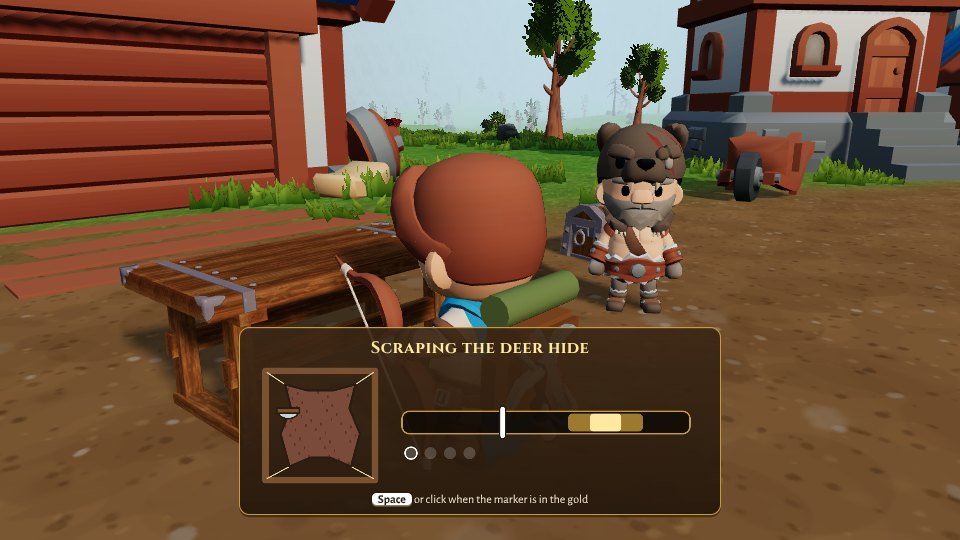
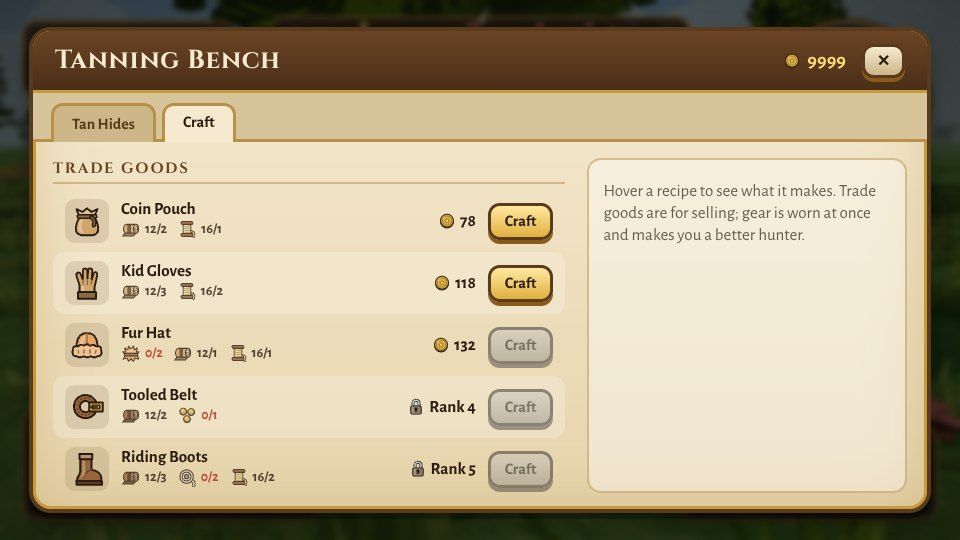
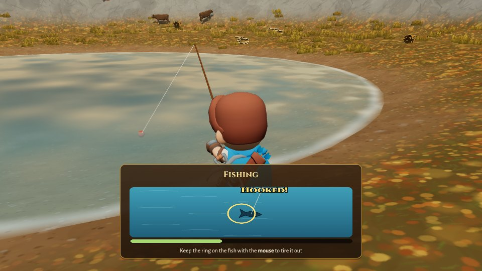
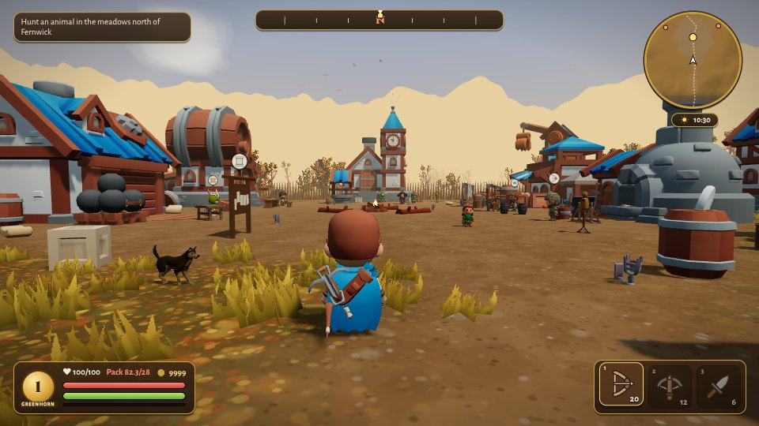

# Hidebound — A Hunter's Trade

A third-person hunting, skinning and leathercraft adventure for desktop browsers, built to the scope and
polish of a GameCube-era title: four regions, four towns, fifteen animals, a full crafting and trade economy,
day/night, generative music, save slots and gamepad support.

**Play:** https://spencer0.github.io/hunting-leather/ (deployed from `main` by GitHub Actions)



| | |
| --- | --- |
|  |  |
|  |  |
|  |  |
|  |  |
|  | |

## The loop

1. **Hunt** — stalk game with bows, crossbows and thrown weapons. Crouch to stay unseen; an unaware animal
   takes far more damage. Head and heart shots count.
2. **Skin** — a clean kill (one arrow, a vital hit, a good knife) gives a *Pristine* hide; a pincushion gives a *Poor* one.
3. **Tan & craft** — scrape hides in a timing minigame at the tanner's bench (good timing means extra leather),
   then lay materials out on a 3×3 pattern grid and stitch them into trade goods or gear. Clean stitching makes
   *Fine* goods that sell for more.
4. **Sell** — every town values things differently. Furs are worth a fortune on the steppe.
5. **Fish** — buy a pole and bait and cast from any lake shore: wait for the bite, track the fish with the
   mouse, then land it with a quick key sequence. Twelve fish, three per region, the rare ones fight harder.
6. **Rank up** — earn Hunter Rank, spend skill points on nine perks, and unlock the wagon road to the next region.
7. **End the legends** — each region hides a legendary beast. The last one has never been taken.

| Region | Town | Rank | Game |
| --- | --- | --- | --- |
| Greenhollow Vale | Fernwick | 1 | Doe, Red Fox, Amber Stag · *Emberclaw* |
| Amberwood | Rusthaven | 4 | Stag, Grey Wolf, Wood Aurochs · *The Amber Monarch* |
| Sunscar Steppe | Dunmarch | 8 | Bison, Vicuña, Dust Jackal · *Ironhorn* |
| Frostfang Peaks | Hollowfrost | 12 | Frostfang Wolf, Rime Elk, Tundra Ox · *Old Rime* |

## Controls

| Action | Keyboard & mouse | Gamepad |
| --- | --- | --- |
| Move / look | WASD / mouse | Left / right stick |
| Sprint · crouch · jump | Shift · C · Space | L3 or B · R3 · A |
| Aim | Right mouse | LT |
| Draw & loose / fire / throw | Left mouse (hold to draw a bow) | RT |
| Bow · crossbow · thrown | 1 · 2 · 3 or wheel | LB / RB |
| Span crossbow | R | — |
| Knife slash (staggers) | F or middle mouse | Y |
| Interact / skin | E | X |
| Drink tonic | H | D-pad up |
| Journal (pack, skills, map) | Tab | Back |
| Pause | Esc | Start |

## Tech

- **three.js + TypeScript + Vite.** (Rust + wasm was considered; for a content-heavy game whose cost is art,
  animation and UI rather than simulation, three.js gets skinned glTF animation, instancing and shadows for free
  and keeps iteration fast.)
- Procedural heightfield terrain per region with splat-mapped, procedurally generated ground textures;
  instanced, wind-animated foliage and grass; shader water with shoreline foam; gradient sky dome with sun, moon,
  stars and clouds; full day/night lighting; soft shadow maps.
- Skinned CC0 models with layered upper/lower-body animation for the hunter, bone-driven hit zones on animals.
- Fully procedural audio score and ambience (WebAudio), plus CC0 sampled effects.
- Saves to `localStorage` (three slots, autosave, sleep-to-save).

```bash
npm install
npm run dev        # http://localhost:5173
npm run build      # typecheck + production build into dist/
```

`tools/build-assets.sh` rebuilds `public/assets` from the raw CC0 packs (see [CREDITS.md](CREDITS.md)).

## Deployment

`.github/workflows/deploy.yml` typechecks and builds on every push and pull request, and deploys `dist/` to
GitHub Pages on pushes to `main`. In the repository settings, **Pages → Source** must be set to
**GitHub Actions** (the workflow attempts to enable this itself).
